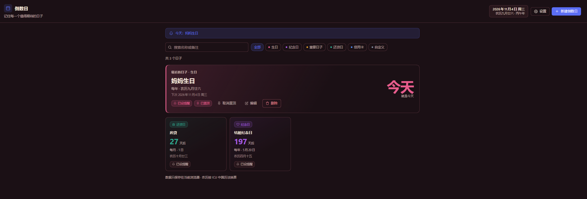

# 倒数日 · Countdown Days

[中文](#中文) · [English](#english) · [界面截图 / Screenshots](docs/screenshots.md)



## 中文

DeepSeek Harness Web 界面的倒数日插件，适合记录生日、纪念日和还款日。支持公历、农历（含闰月）、重复日期和提醒。数据保存在浏览器本地。

### 安装

需要支持插件 bundle 的 DeepSeek Harness Web 环境。下载或克隆本仓库后，在 Harness 中调用 `plugin_manager` 工具（不是终端命令）：

```json
{"action":"install_bundle","target":"<countdown-days 目录的绝对路径>"}
```

Windows 路径在 JSON 中需将反斜杠写为 `\\`。也可以请 Harness agent 用该工具安装本地目录。安装影响当前 profile 的所有会话；查看返回的 `application` 和 `warnings`，按提示操作，必要时刷新页面。若以本地链接安装，请保留目录。可在插件管理界面卸载；卸载前请备份，卸载不保证清除浏览器数据。

### 使用

1. 在侧边栏打开「倒数日」，点击「新建倒数日」，填写名称、分类和日期。
2. 公历可选择不重复、每周、每月或每年；农历可选择不重复或每年。设置提醒时间和当天或提前 1、3、7、14、30 天的提醒，保存即可。新记录默认选择当天及提前 1、3 天；设置中的默认时间只影响新记录。
3. 可搜索名称或备注、按分类筛选，也可编辑、删除和置顶记录。

公历每月重复遇到不存在的日期取月底，2 月 29 日每年重复在非闰年取 2 月 28 日。农历每年重复遇到不存在的闰月时尝试同序号普通月；农历三十不存在时取二十九，仍无对应日期则跳过。日期输入范围为 1900–2100 年。农历换算依赖浏览器 ICU 中国历法，不支持该历法的环境无法换算，与其他万年历在少数日期也可能不同。

### 提醒

在设置中开启「桌面通知」可启用定时提醒检查；关闭它也会关闭定时站内提醒。站内提示需要面板打开才能显示；面板中的当天提示条不受该开关影响。系统通知还需点击「允许通知」，并检查浏览器和系统权限。

提醒依赖页面及插件持续加载。关闭页面、设备休眠或浏览器限制后台计时可能导致延迟或漏报；重新加载后只会补查当天已到时间的提醒，不补发过去提醒日。不要将其作为重要事项的唯一提醒方式。

### 备份与隐私

在「设置 → 数据管理」导出 JSON 备份。导入会在确认后**覆盖全部当前记录**，不会合并；恢复前建议先导出当前记录。备份不包含通知开关、默认提醒时间和提醒去重历史。无效、版本不受支持或超过 500 条记录的备份会被整体拒绝。

记录和设置保存在当前浏览器、当前来源的 localStorage 中，未加密；插件不主动发送网络请求，也不提供云同步。同源脚本或能访问浏览器数据、设备的人可能读取这些信息。清除站点数据、更换浏览器或来源可能丢失记录，建议定期备份。备份包含明文名称、日期和备注，系统通知也可能在锁屏等位置显示名称，请注意保护。

若现有数据无法读取，插件会保留原始数据并停用保存和导出；请勿清除站点数据。避免同时在多个页面编辑，以免并发写入冲突。

## English

A countdown plugin for the DeepSeek Harness Web UI, for birthdays, anniversaries, payment dates and more. It supports Gregorian and Chinese lunar dates (including leap months), recurring events and reminders. Data stays in the browser.

### Installation

You need a DeepSeek Harness Web environment that supports plugin bundles. Download or clone this repository, then call the `plugin_manager` tool in Harness (this is not a terminal command):

```json
{"action":"install_bundle","target":"<absolute path to the countdown-days directory>"}
```

For Windows paths, escape backslashes as `\\` in JSON. You can also ask the Harness agent to install the local directory using this tool. Installation affects all sessions in the current profile. Check the returned `application` and `warnings`, follow their guidance and refresh the page if needed. If installed as a local link, keep the directory in place. You can uninstall through the plugin manager; export a backup first, since uninstalling does not guarantee removal of browser data.

### Usage

1. Open **Countdown Days** in the sidebar, select **Add countdown**, and enter a name, category and date.
2. Gregorian dates can repeat weekly, monthly, yearly or not at all; lunar dates can repeat yearly or not at all. Set a reminder time and choose the day itself or 1, 3, 7, 14 or 30 days before, then save. New events default to the day itself and 1 and 3 days before; the default time in Settings applies only to new events.
3. Search by name or note, filter by category, or edit, delete and pin events.

A monthly Gregorian date that does not exist falls on the last day of the month; February 29 falls on February 28 in non-leap years. For yearly lunar events, a missing leap month falls back to the corresponding regular month; a missing 30th day falls back to the 29th. If no date is found, that year is skipped. Input years are limited to 1900–2100. Lunar conversion requires the browser's ICU Chinese calendar and may differ from other calendars on a few dates.

### Reminders

Turn on **Desktop notifications** in Settings to enable scheduled reminder checks; turning it off also disables scheduled in-app reminders. The panel must be open to show an in-app toast, but its today banner does not depend on this switch. System notifications also require **Allow notifications** and browser and system permission.

Reminders require the page and plugin to remain loaded. Closing the page, device sleep or background timer restrictions can delay or prevent them. After a reload, only reminders due on the current day are checked; past reminder days are not replayed. Do not rely on this as the sole reminder for important matters.

### Backup and privacy

Use **Settings → Data → Export backup** to download a JSON backup. Importing **replaces all current events** after confirmation; it does not merge them. Export the current data before restoring. Backups do not include the notification switch, default reminder time or reminder deduplication history. Invalid or unsupported backups, or those with more than 500 events, are rejected in full.

Events and settings are stored unencrypted in localStorage for the current browser and origin. The plugin does not make network requests or provide cloud sync. Same-origin scripts and people with access to the browser data or device may read them. Clearing site data or changing browser or origin can lose records, so back up regularly. Backups contain names, dates and notes in plain text; system notifications may also show names on the lock screen or elsewhere.

If existing data cannot be read, the plugin preserves the original data and disables saving and export; do not clear site data. Avoid editing in multiple pages at once to reduce write conflicts.

## License / 许可证

[MIT](LICENSE)
