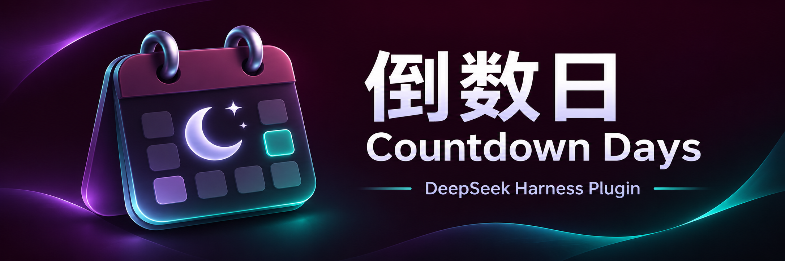

# 倒数日 / Countdown Days



[中文](#中文) · [English](#english) · [截图 / Screenshots](docs/screenshots.md)

## 中文

在 DSH 里记住生日、纪念日和还款日。支持公历、农历（含闰月）、重复日期、分类、置顶和提醒，无云同步。

### 安装

1. 下载或克隆仓库，保留本地目录。
2. 请 DSH agent 用 `plugin_manager` 安装该目录，或直接调用工具（不是终端命令）：

   ```json
   {"action":"install_bundle","target":"<countdown-days 目录的绝对路径>"}
   ```

3. 按返回提示刷新页面，从侧边栏打开「倒数日」。

需要支持 bundle 的 Harness。安装影响当前 profile；Windows JSON 路径中的反斜杠写成 `\\`。本地链接安装后请勿删除源码目录。

### 添加日子

1. 点击「新建倒数日」，填写名称和分类。
2. 选择公历或农历日期，设置重复方式。
3. 选择提前提醒天数和时间，保存。

公历支持每周、每月或每年重复；农历支持每年重复，换算依赖浏览器 ICU 中国历法。列表支持搜索、编辑、删除和置顶。

### 开启提醒

1. 在设置中打开「桌面通知」，启用定时提醒检查。
2. 允许浏览器通知，并检查系统通知权限。
3. 点击「发送测试提醒」确认通知能显示。

页面需要持续加载；关页、休眠或后台限制可能漏报。当天提示条不受通知开关影响。重要事项请保留其他提醒方式。

### 备份与恢复

1. 在设置中导出 JSON 备份。
2. 恢复前先备份当前记录，再导入文件。
3. 确认替换：**导入会覆盖全部现有记录，不会合并**。

数据和备份未加密。清除站点数据、更换浏览器或来源地址可能丢失记录；通知可能出现在锁屏上，请勿填写敏感内容。

[详细说明](docs/guide.md) · [反馈问题](https://github.com/Veagau/dsh-countdown-days/issues)

### 开发

```sh
npm run check
npm test
```

包含农历、存储、备份和设置回归测试，不代表完整浏览器兼容性测试。

## English

Track birthdays, anniversaries and payment dates in DSH. Supports Gregorian and Chinese lunar dates (including leap months), recurrence, categories, pinning and reminders. No cloud sync.

### Install

1. Download or clone the repository and keep the local directory.
2. Ask a DSH agent to install it with `plugin_manager`, or call the tool directly (not a shell command):

   ```json
   {"action":"install_bundle","target":"<absolute path to countdown-days>"}
   ```

3. Follow the returned instructions, refresh if needed and open **Countdown Days** from the sidebar.

Requires a bundle-capable Harness. Installation affects the current profile. Escape Windows path backslashes as `\\` in JSON. Keep the source directory if installed as a local link.

### Add an event

1. Select **Add countdown** and enter a name and category.
2. Choose a Gregorian or lunar date and recurrence.
3. Set reminder days and time, then save.

Gregorian dates repeat weekly, monthly or yearly; lunar dates repeat yearly and require the browser's ICU Chinese calendar. Search, edit, delete and pin events from the list.

### Enable reminders

1. Turn on **Desktop notifications** in Settings to enable scheduled checks.
2. Allow browser notifications and check system notification permissions.
3. Send a test reminder to check that notifications appear.

The page must stay loaded. Closing it, device sleep or background restrictions can cause missed reminders. The today banner works independently of the notification switch. Keep another reminder for important events.

### Back up and restore

1. Export a JSON backup from Settings.
2. Back up current events before importing a file.
3. Confirm replacement: **import replaces all existing events; it does not merge them**.

Data and backups are unencrypted. Clearing site data or changing browser or origin can lose records. Notifications may appear on the lock screen; avoid sensitive content.

[Full guide](docs/guide.md) · [Report an issue](https://github.com/Veagau/dsh-countdown-days/issues)

### Development

```sh
npm run check
npm test
```

Includes lunar, storage, backup and settings regressions, not complete browser compatibility testing.

## License

[MIT](LICENSE)
