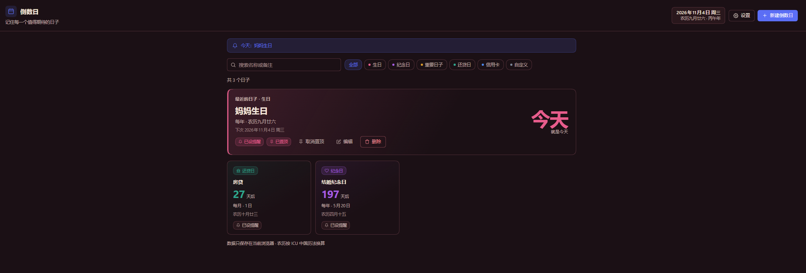
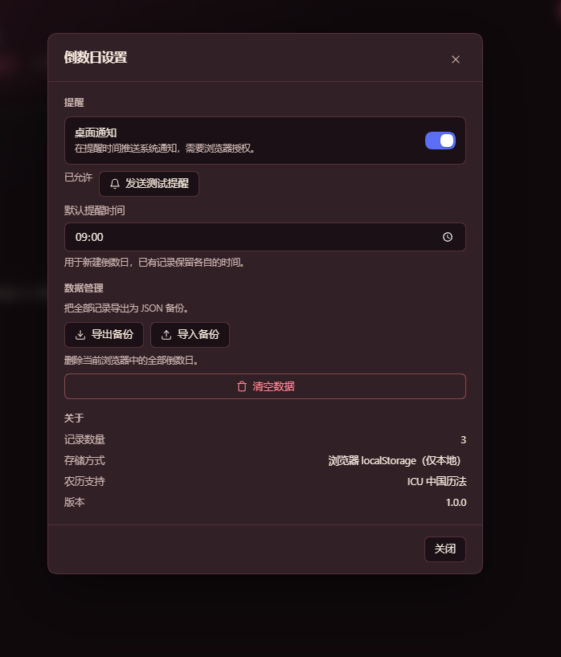
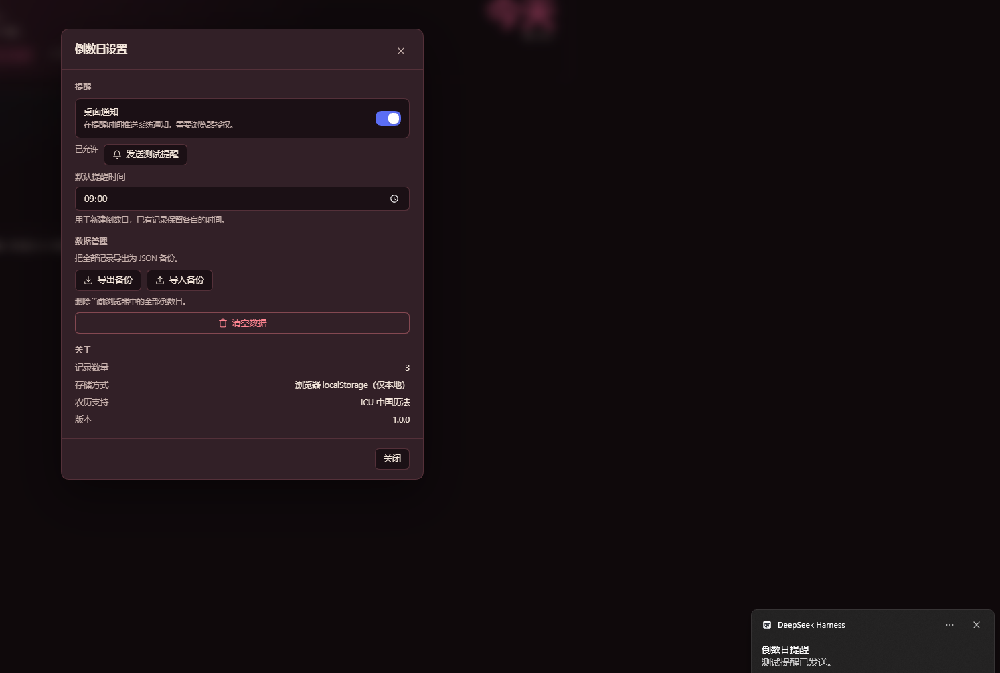

# 界面展示 / Screenshots

用户提供的实机截图，拍摄于 2026-11-04。仅作为界面展示，不代表完整功能测试。截图设置页显示 1.0.0，而仓库已发布 1.0.1；未据此确认安装版本，不将这些图片标为 1.0.1 测试证据。

User-provided screenshots captured on November 4, 2026, for UI illustration rather than complete functional verification. Settings displays 1.0.0 while the repository has released 1.0.1. The installed version is not established by these images, so they are not presented as evidence of testing version 1.0.1.

## 日期列表 / Event list

农历生日、每月还款与每年纪念日，以及当天提示和置顶入口。
A lunar birthday, monthly payment date and yearly anniversary, with a today banner and pin controls.

## 设置与备份 / Settings and backups

通知权限、默认提醒时间和 JSON 导入导出入口。
Notification permission, default reminder time and JSON import/export controls.

## 测试通知 / Test notification

截图中系统显示“测试提醒已发送”。这只展示手动测试通知，不证明后台定时提醒、休眠唤醒或关页后仍会通知。
The system notification says a test reminder was sent. This illustrates a manual notification test, not scheduled background delivery, wake-from-sleep behavior or notifications after the page closes.

## 验证范围 / Validation scope

源码静态检查、UTC / America/New_York / Australia/Lord_Howe / Pacific/Apia 四时区农历回归、存储与备份测试、设置与探针测试已通过。完整浏览器 UI 与宿主兼容矩阵尚未验证。

Source checks, lunar regressions in UTC / America/New_York / Australia/Lord_Howe / Pacific/Apia, storage and backup tests, and settings/probe tests passed. Complete browser UI coverage and a host compatibility matrix have not been verified.

新建页原图显示日期已有值但仍提示“请选择有效日期”，该现象尚待复现，因此未列作正常流程示例。
The supplied creation-form image shows a populated date alongside a request to select a valid date. This observation still needs reproduction and is not included as a successful workflow example.
